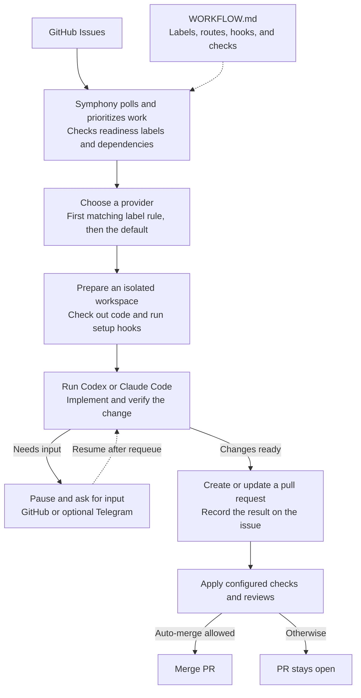

# Symphony

Symphony is a self-hosted harness that runs coding agents from a GitHub Issues queue. Each repository's `WORKFLOW.md` defines which issues are eligible, how agents work, and what checks apply before delivery.



Symphony can run Codex and Claude Code in parallel, retry interrupted work, and track runs in a local read-only dashboard. Workflows can also enable PR review handling and automatic merging.

## Quick start

You’ll need Node.js 22.5+, Yarn Classic 1.22, Git, an authenticated GitHub CLI (`gh`), and the coding-agent CLIs your workflow uses.

```bash
git clone https://github.com/maskaravivek/symphony.git
cd symphony
yarn install --frozen-lockfile
cp WORKFLOW.example.md ../your-repo/WORKFLOW.md
```

Edit the copied `WORKFLOW.md` to set the GitHub owner and repo, labels, workspace paths, and agent prompt. Adapt the hooks and permissions, and keep only the providers you plan to use. Commit the workflow and create the labels it references. The [onboarding skill](.agents/skills/symphony-onboard-repo/SKILL.md) covers setup and label provisioning.

```bash
yarn cli doctor --workflow ../your-repo/WORKFLOW.md
yarn dev run --workflow ../your-repo/WORKFLOW.md
```

Once Symphony is running, add `ready-for-agent` (or your configured readiness label) to a GitHub issue. The dev command opens the dashboard, which refreshes every five minutes by default. Select **Refresh now** for an immediate update. If Symphony is already running in the background, start just the dashboard with `yarn cli dashboard --config symphony.config.yml`. Use `yarn cli --help` for commands such as `status`, `tail`, and `history`.

## Further setup

- **Multiple repositories** — start from [the server config example](symphony.config.example.yml) and pass `--config` in place of `--workflow`.
- **Workflow policies and operations** — see the [operations guide](docs/operations.md) for routing, issue grooming, review gates, workspace maintenance, and scheduled runs.
- **Telegram** — use the [optional bridge](docs/telegram.md) for issue intake, private replies to agent questions, and notifications.

Adapted from [OpenAI's Symphony specification](https://openai.com/index/open-source-codex-orchestration-symphony/) for GitHub Issues.
