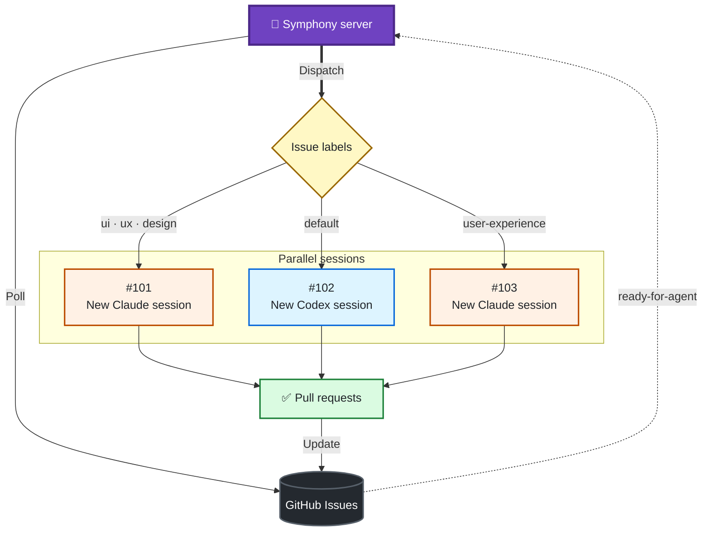

# Symphony

Symphony turns GitHub Issues into a queue for coding agents. It watches for eligible issues, creates an isolated workspace for each one, and runs the agent workflow defined by your repository.



## Background

This project is based on OpenAI's [original Symphony specification](https://openai.com/index/open-source-codex-orchestration-symphony/), adapted to use GitHub Issues instead of Linear.

The central idea is the same: your issue tracker is the control plane, while a repository-owned `WORKFLOW.md` defines how agents work, test, and hand off changes.

## Getting started

### 1. Install the prerequisites

You need:

- Node.js 22.5 or newer
- Yarn 1.22
- Git and the [GitHub CLI](https://cli.github.com/), authenticated with access to your target repository
- At least one coding-agent CLI referenced by your workflow, such as Codex or Claude Code

Clone and install Symphony:

```bash
git clone https://github.com/maskaravivek/symphony.git
cd symphony
yarn install --frozen-lockfile
```

### 2. Add a workflow to your repository

Copy [`WORKFLOW.example.md`](WORKFLOW.example.md) into the repository you want Symphony to manage:

```bash
cp WORKFLOW.example.md ../your-repo/WORKFLOW.md
```

Edit the new `WORKFLOW.md` in your target repository. At minimum, update:

- `tracker.owner`, `tracker.repo`, labels, and authentication
- `workspace.root` and the repository clone commands in `hooks`
- the agent providers, commands, and routing you intend to use
- the Markdown prompt below the YAML front matter

The example is a full starting point, not a drop-in configuration. Remove optional providers, quota checks, review rules, and merge behavior that you do not need. Commit `WORKFLOW.md` to the target repository so its agent policy is reviewed and versioned with the code.

For repeatable onboarding, use the repository's [symphony-onboard-repo skill](.agents/skills/symphony-onboard-repo/SKILL.md). It covers workflow authoring, central registration, merge/routing/storage policy, idempotent GitHub label provisioning, doctor checks, and the existing Telegram bridge. Invoke it with `$symphony-onboard-repo` and the target repo path; it does not start agents or queue issues as an onboarding side effect.

### 3. Validate the setup

Create the lifecycle labels referenced by your workflow, authenticate GitHub, and run the built-in checks:

```bash
gh auth status
yarn cli doctor --workflow ../your-repo/WORKFLOW.md
```

`doctor` checks the workflow, required tools, GitHub lifecycle/routing/priority/planning/epic labels, workspace storage, and agent configuration. It also reports impossible or shadowed routes, misplaced default routes, and concrete cases where an explicit `agent:*` label selects another provider group.

### 4. Run Symphony

```bash
yarn dev run --workflow ../your-repo/WORKFLOW.md
```

In development mode, Symphony starts the orchestrator and opens a local read-only dashboard. Add the workflow's required label—`ready-for-agent` in the example—to a well-scoped GitHub issue to queue it.

Useful commands:

```bash
yarn cli status --workflow ../your-repo/WORKFLOW.md
yarn cli tail 123 --workflow ../your-repo/WORKFLOW.md
yarn cli history 123 --workflow ../your-repo/WORKFLOW.md
```

Replace `123` with a GitHub issue number. To run multiple repositories from one Symphony process, start with [`symphony.config.example.yml`](symphony.config.example.yml) and pass `--config` instead of `--workflow`.

For those repositories, optional primary-checkout sync keeps local workflows and other files current with remote `main`:

```yaml
repository_sync:
  enabled: true
  interval_ms: 43200000 # 12 hours
```

When enabled, Symphony runs a sync pass before polling repository agents, initially at startup and then every 12 hours. The last attempt is saved in `.symphony/repository-sync.json` beside the central config, so restarts do not reset the interval. Each enabled workflow's containing Git checkout is deduplicated and fetched from `origin/main`, then updated only by a fast-forward. Dirty or divergent checkouts, other branches, Git operations in progress, linked task worktrees, and repositories with active agents are skipped until the next scheduled pass. Local and ignored files are preserved; sync never resets, cleans, stashes, or switches branches. Outcomes are logged, and a failed repository does not block the others or normal task polling. This does not update or restart Symphony itself. New task workspaces continue fetching their base branch before each run independently of this schedule. The feature is disabled by default.

## TaskDrop intake and grooming

TaskDrop GitHub captures automatically receive `requires-grooming`; a selected `ready-for-agent` label is replaced by the intake gate. Symphony polls intake alongside its normal five-minute queue, using the default provider's read-only handoff command and shared/specialized issue planner guidance. Grooming consumes normal concurrency and usage/disk limits, inspects the repo and issue conversation, and requires structured scope, acceptance criteria, verification, evidence and exactly one configured priority. It preserves the raw capture and attachments and posts the enriched brief as an idempotent issue comment, so implementation receives it through normal run context. Grooming does not implement, create PRs/epics, or run the PR finalization hook.

Clear bounded work is labeled for the normal workflow, with the intake gate removed last. Existing unrelated, risk and explicit agent labels remain intact. Required user decisions use the normal pause protocol; the paired Telegram bridge sends the question, records your answer, and requeues grooming. Duplicate/large/unsupported work can be marked for human attention. The intake label blocks implementation and auto-merge even if readiness is accidentally also present; removing it manually opts out of grooming. Invalid output, stale input or operational failures do not make an issue ready, and retry limits still apply. Restarts recover durable finalization before dispatch. GitHub issues created outside TaskDrop can opt into the same pipeline by adding the intake label. Linear destinations are unchanged.

## Issue planning

Use [`$symphony-plan-issues`](.agents/skills/symphony-plan-issues/SKILL.md) to turn plans and findings into repo-aware GitHub issues or native epics. The shared skill reads the target workflow for priorities, agent routing, validation and readiness. Portable copies are installed in the seven smaller repositories; mdedit retains its specialized issue planner. The canonical shared definition lives here, and onboarding installs it for new repos without a specialized planner. Creating issues does not queue them unless execution is authorized.

## Label routing

Routes use the first matching rule. In the example workflow, explicit `agent:codex` comes first (and wins if both overrides are present). `agent:claude` selects Claude, or `claude-fable` for high/critical complexity, before any task-based rule. High/critical UX work selects `claude-fable`; tiny/docs/chore tasks use regular Codex; other UX work, including low/medium complexity, uses Claude. Everything else uses Codex. No Spark provider is configured.

All execution modes still require `ready-for-agent` and respect blocking/human-attention labels. `planning` or `task:spec` requests a planning-only run. Epic coordination uses native GitHub sub-issues; provider/complexity labels do not inherit from the parent. With `auto_label_children: false`, label each child `ready-for-agent` explicitly. Legacy aliases such as `agent-ready` do not queue work. The seven configured side projects intentionally use a single default Codex route.

## Daily storage maintenance

Symphony runs storage maintenance on the first eligible tick and every 24 hours afterward, in both single- and multi-repository mode. Each workspace root saves its completed pass in `.symphony/storage-maintenance.json`, so restarting does not reset the schedule. Maintenance holds the workflow lock and defers while the repository has active workers. It does not need GitHub to be available. No separate scheduled job is needed; Symphony must be running.

Defaults can be overridden in each repository's `WORKFLOW.md`:

```yaml
workspace:
  storage_maintenance:
    enabled: true
    interval_ms: 86400000
    min_free_gib: 20
    idle_days: 7
    retention_days: 30
    max_artifact_gib: 2
    max_pool_slots: 8
    # Optional, exclusively owned Symphony cache; never point at a primary checkout.
    cache_root: ~/.symphony/cache/my-repo
    max_cache_gib: 10
```

- Archives expire after 30 days and have a 2 GiB budget per repository. Archiving moves artifacts within the same filesystem instead of temporarily duplicating them.
- Session evidence is limited to 50 sessions and 2 GiB per workspace, across issues sharing a pool. The current/latest session is protected even if it exceeds the budget. Daily pruning covers completed, failed and cancelled runs; dispatch also prunes before starting another session. Active, paused, retrying and finalizing evidence is preserved.
- After seven idle days, completed, failed and cancelled workspaces may be reclaimed even if their issue is still open, when `clean_on_terminal` is enabled. Maintenance requires a clean checkout, no stashes or Git operation in progress, and all local branch/tag/HEAD commits reachable from remote-tracking refs. Unknown ignored files prevent removal; only `.symphony`, root dependency folders and known root build outputs are disposable. Run evidence is archived first. Linked worktrees, symlinks, invalid/missing run state and recoverable local work are preserved.
- Pool growth is capped at eight slots or configured agent concurrency, whichever is larger. Existing reserved slots above the cap can still resume. Exhaustion leaves tasks queued without spending retry attempts.
- Hook logs expire after 30 days, with 100 MiB per workspace's hook-log directory. Persistent application logs are pruned during runtime writes as dates change and rotate at 25 MiB, retaining three rotated files per day.
- An explicitly configured cache keeps at most three dependency snapshots, up to 10 GiB total, expiring after 14 days without use. Yarn v6 package entries have a separate 10 GiB / 30-day limit. Cache locks prevent cache pruning. Git mirrors are preserved because clones can reference their objects through alternates. Hooks that reuse dependency snapshots should touch their snapshot directory to record use; mdedit does this.

Before new issue/review/conflict/loop work, Symphony checks for at least 20 GiB free. Low space or an unavailable filesystem pauses dispatch while reconciliation and active jobs continue. Dispatch resumes automatically when space returns. The Telegram bridge reports pause and recovery transitions once; it reads `.symphony/storage-status.json` without changing task lifecycle labels. This guard remains enabled when periodic maintenance is disabled.

Maintenance intentionally leaves removed repositories, unknown directories, episode history, Git mirrors, shared system caches, and launchd stdout/stderr logs untouched. It does not promise a hard total disk cap: protected work and an active build can exceed retention budgets or consume the free-space reserve. Outcomes and failures are logged; the completion record includes removed workspace counts and artifact/cache bytes, excluding bytes removed with a checkout.

## Features

- **GitHub-native queue:** Selects work through issue labels, priorities, native dependencies, and native sub-issue epics.
- **Isolated execution:** Creates a dedicated workspace and durable run artifacts for each issue.
- **Repository-owned policy:** Keeps agent commands, hooks, prompts, review rules, and merge policy in `WORKFLOW.md`.
- **Multiple agents:** Routes work to configured providers such as Codex or Claude Code, with per-provider concurrency and usage checks.
- **Recovery and retries:** Resumes agent threads, retries transient failures, and recovers interrupted work after a restart.
- **Review and delivery:** Can shepherd external PR feedback and apply an opt-in, deterministic autonomous merge policy.
- **Local visibility:** Provides a read-only dashboard, CLI status tools, logs, run artifacts, and a SQLite event ledger.
- **Multi-repository operation:** Runs one workflow or coordinates several repositories from a central config.

For private Telegram questions, replies, and outcome notifications alongside your existing orchestrator, see the optional [Telegram bridge setup](docs/telegram.md).

By default, autonomous merging requires one fresh passing review for both standard and elevated changes. With PR shepherding enabled, a fresh Codex review bot approval can supply that review even when Symphony's own post-run review is disabled. Elevated changes still require any additional verification evidence configured in the workflow. Blocking findings, human pauses, prohibited changes, and unsuccessful checks continue to prevent automatic merging.

For projects that ship without code review, set `review.enabled: false`, `review.shepherd_pull_requests: false`, and configure local validation:

```yaml
merge:
  enabled: true
  required_reviews: 0
  require_checks: false
  validation_command: |
    yarn install --frozen-lockfile
    yarn test
    yarn build
```

Use the project's actual check commands. Symphony runs them after successful PR finalization, requires a clean workspace with matching local and remote head/base commits, and records validation evidence without inventing a review approval. A failed or interrupted rerun invalidates the previous success. Eligible PRs merge on a subsequent polling cycle; pending or failing GitHub checks still block merging even when checks are optional. Paused, blocked, closed, and actively running linked issues are excluded. Recovery revalidates interrupted runs. An agent's successful exit alone is insufficient, and repositories using the default review policy are unaffected.

## Limitations

- Symphony is an early-stage, self-hosted tool. It is not a managed service or multi-tenant control plane, and its configuration may change.
- This implementation supports GitHub Issues, not Linear or other issue trackers.
- It is currently run from source and is not published as an npm package.
- The dashboard is for local, read-only operational visibility; project management stays in GitHub.
- Results depend on clear issues, strong repository instructions, and reliable tests. Ambiguous work still benefits from an interactive agent session.
- `WORKFLOW.md` contains executable shell commands. Those commands inherit the host and agent permissions you configure. Review the example's approval and sandbox settings before running it against a repository.
- GitHub writes, commits, pushes, and pull requests are performed by the configured agent and tools; Symphony primarily schedules work, manages lifecycle state, and records outcomes.
